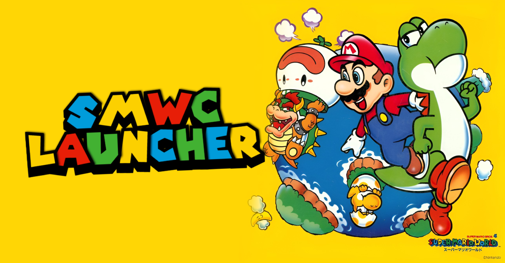
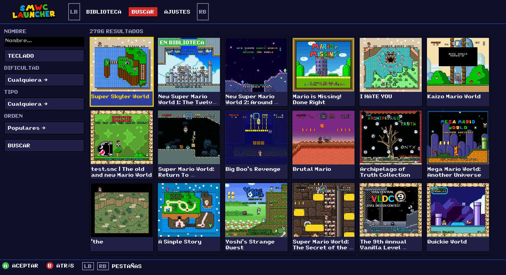
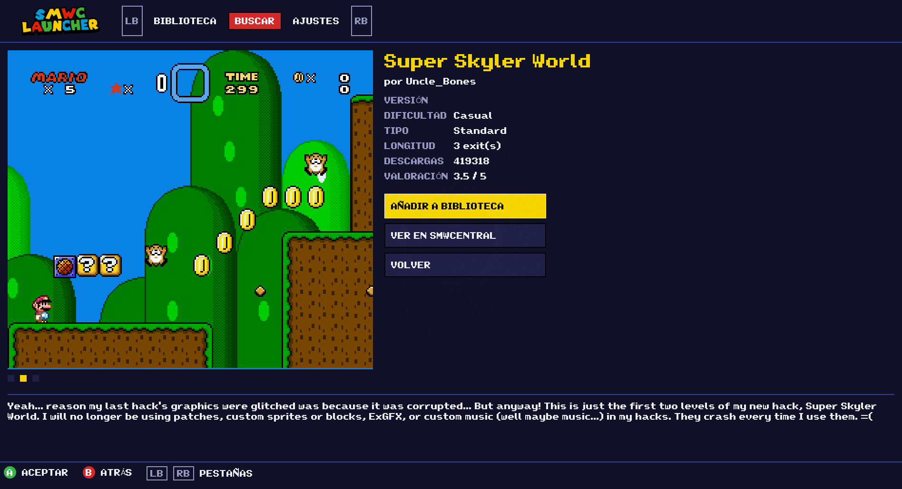

# smwc_launcher



A console-style launcher to download, patch and play Super Mario World hacks from [SMWCentral](https://www.smwcentral.net/), with the Snes9x emulator built in. Written in Rust with [egui](https://github.com/emilk/egui) and designed to be used 100% with a gamepad (mouse and keyboard work too).

- Library of downloaded hacks and SMWCentral search with filters (name, difficulty, type, sort order).
- Automatic download and patching (BPS / IPS) onto your original SMW (USA) ROM.
- Built-in Snes9x emulator (libretro) with a pause menu and save files (`.srm`).
- Spanish and English interface.

## Screenshots





## Building

Requires [Rust](https://rustup.rs/).

```sh
cargo build --release
./target/release/smw-launcher
```

### Snes9x core

The built-in emulator uses the Snes9x libretro core. To build it (requires `g++` and `make`):

```sh
git clone --depth 1 https://github.com/snes9xgit/snes9x
make -C snes9x/libretro -j"$(nproc)"
mkdir -p ~/.local/share/smw-launcher/cores
cp snes9x/libretro/snes9x_libretro.so ~/.local/share/smw-launcher/cores/
```

It is also detected in `/usr/lib/libretro/` (`libretro-snes9x` package) or `~/.config/retroarch/cores/`, and you can pick another core or an external emulator in **Settings**.

## Controls

| | Gamepad | Keyboard |
|---|---|---|
| Move | D-pad / stick | Arrows / Tab |
| Select / Back | A / B | Enter / Esc |
| Switch tab | LB / RB | — |
| Pause in game | HOME or SELECT+START | Esc |
| SNES buttons | By position | X=A, Z=B, S=X, A=Y, Q=L, W=R, Enter=Start, Backspace=Select |
| Fullscreen | — | F11 |

## Tests

```sh
cargo test
# Real tests against SMWCentral and the core:
SMW_ROM=/path/smw.sfc SMW_CORE=/path/snes9x_libretro.so cargo test -- --ignored
```

## Credits

- Based on the idea of [SMWCentral-Downloader-Patcher](https://github.com/iamtheratio/SMWCentral-Downloader-Patcher).
- [SMWCentral](https://www.smwcentral.net/) API (reference: [smwc-api-python](https://github.com/R3tr0BoiDX/smwc-api-python)).
- [smw-font](https://github.com/vvye/smw-font) by wye, licensed [CC BY-NC 4.0](assets/FONT-LICENSE.md); converted to TTF with `assets/font2ttf.py`.
- [Snes9x](https://github.com/snes9xgit/snes9x) emulator (own license, non-commercial use).

No ROM is included: you need your own copy of Super Mario World (USA).
